<p align="center">
  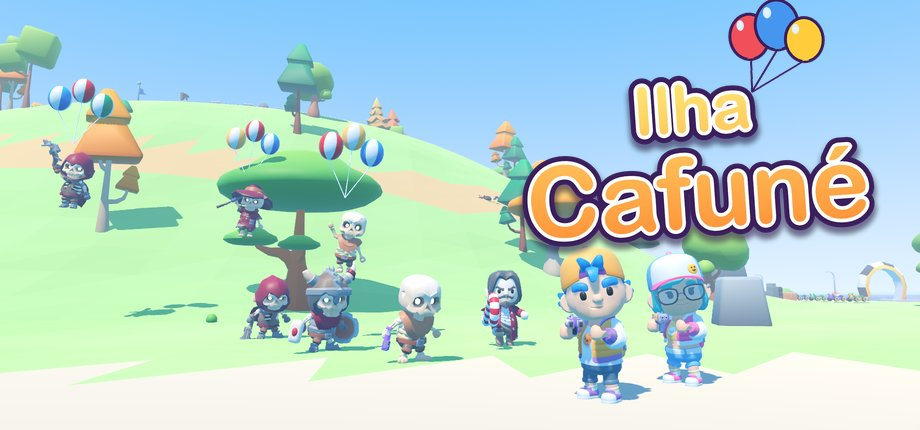
</p>

# Ilha Cafuné

Jogo de tiro em terceira pessoa para crianças de 6 a 12 anos, feito na Godot 4.7, num mundo aberto pequeno e
colorido. Na véspera da Festa do Cafuné, o Mestre Ossinho acende quatro lanternas mágicas e os esqueletos vêm em
ondas para levar a festa embora. Um menino e uma menina pegam os blasters de doce e defendem cada região da ilha.

Ninguém se machuca: esqueleto derrotado ganha balões e volta voando para o Morro, acenando. Sem corações, o
aventureiro fica tonto vendo estrelinhas e volta na última bandeira. No fim, todo mundo descobre que os
esqueletos só queriam ser convidados para a festa.

## Como é o jogo

<table>
  <tr>
    <td width="50%">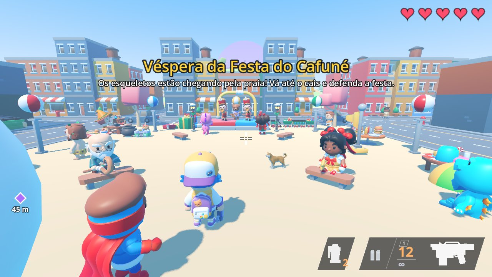<br><sub>Véspera da festa: a primeira onda chega pela praia do cais.</sub></td>
    <td width="50%">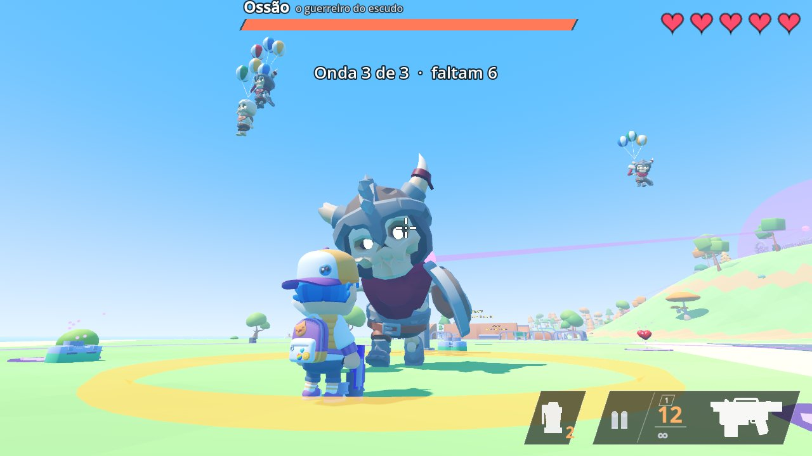<br><sub>Ossão, o guardião do escudo e do martelinho, e a onda de choque no chão.</sub></td>
  </tr>
  <tr>
    <td>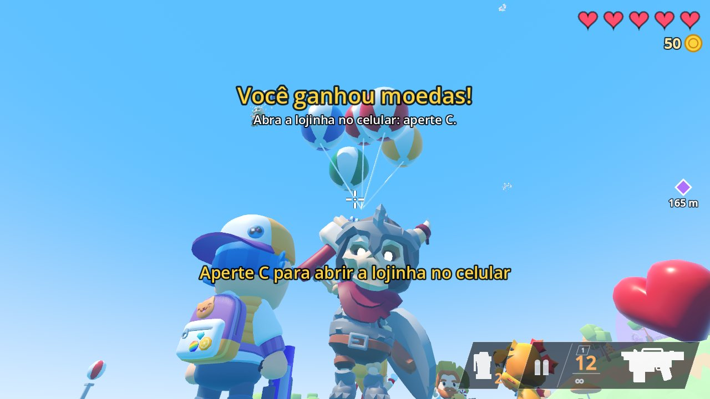<br><sub>Lanterna apagada: o guardião vai embora de balão.</sub></td>
    <td>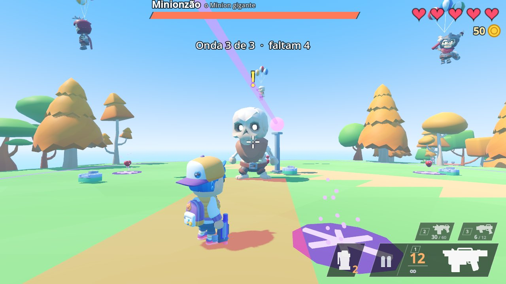<br><sub>Minionzão, o guardião da mata.</sub></td>
  </tr>
  <tr>
    <td>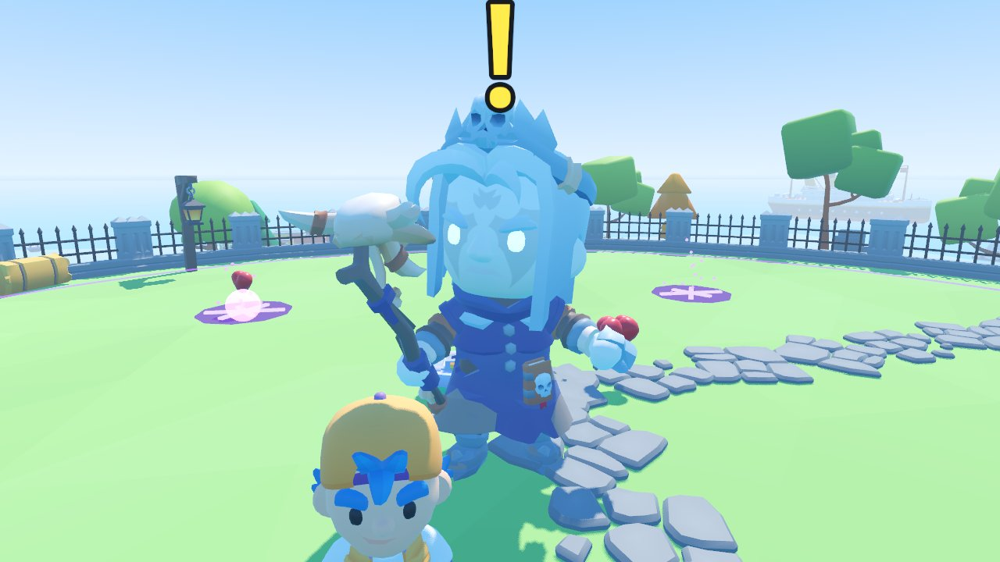<br><sub>A luta final contra o Mestre Ossinho, no cemitério do Morro.</sub></td>
    <td>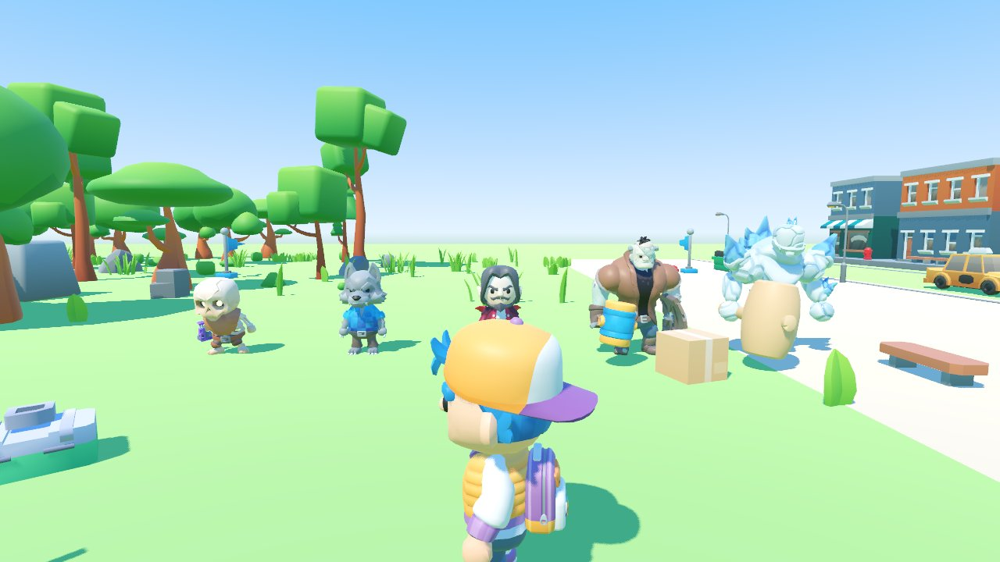<br><sub>Pistoleiro, Lobinho, Conde, Grandalhão e Golem de Gelo, com brinquedos e doces nas mãos.</sub></td>
  </tr>
  <tr>
    <td>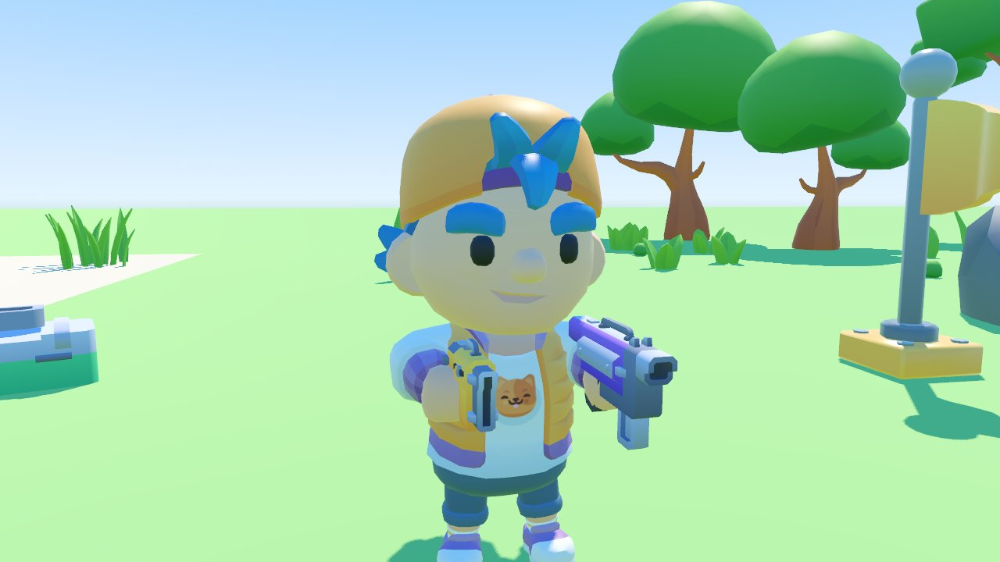<br><sub>Duas pistolas, uma em cada mão: atira mais, mas espalha e tira menos.</sub></td>
    <td>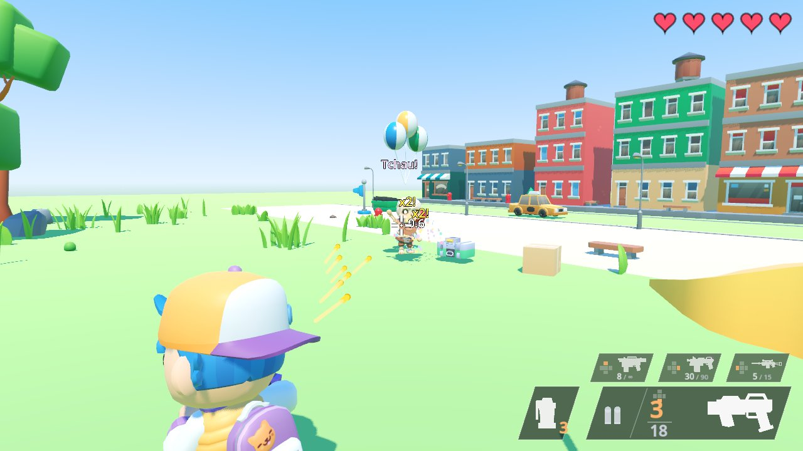<br><sub>Os blasters soltam dardos de espuma coloridos.</sub></td>
  </tr>
  <tr>
    <td>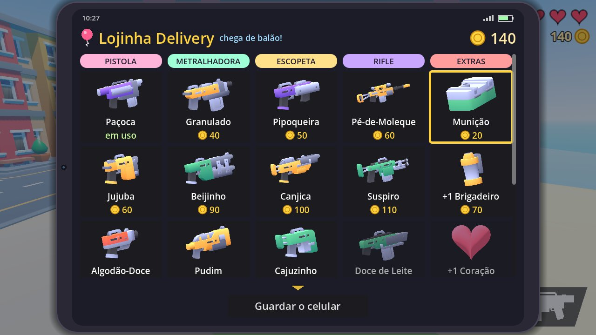<br><sub>Lojinha no celular: as moedas das lutas viram blasters, munição e corações.</sub></td>
    <td>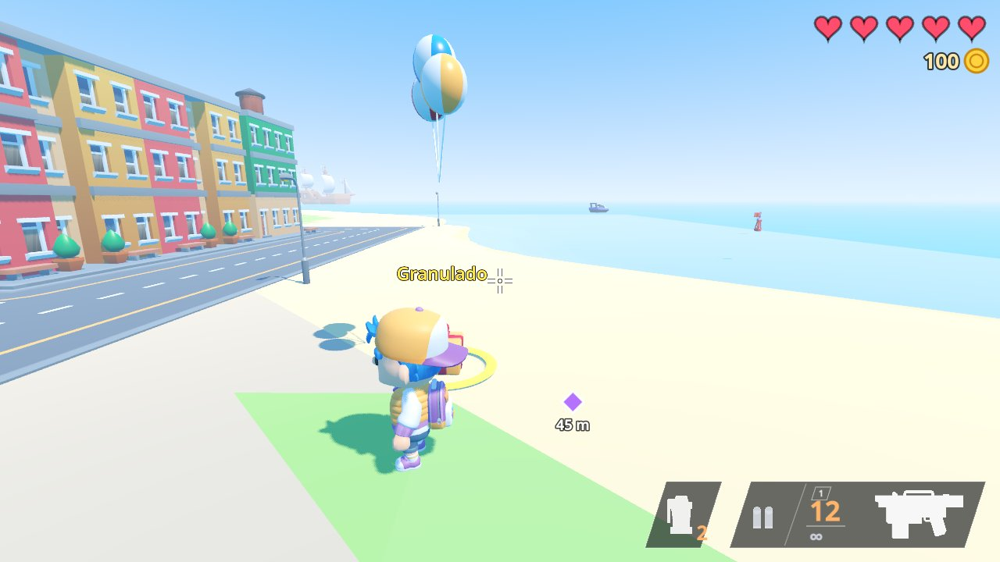<br><sub>O que se compra desce do céu de balão, na frente do aventureiro.</sub></td>
  </tr>
  <tr>
    <td>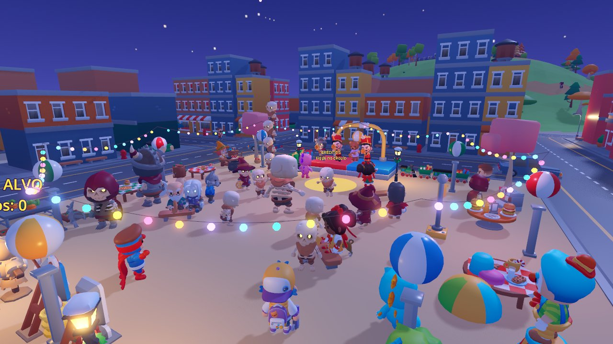<br><sub>A Festa do Cafuné, com os esqueletos convidados.</sub></td>
    <td>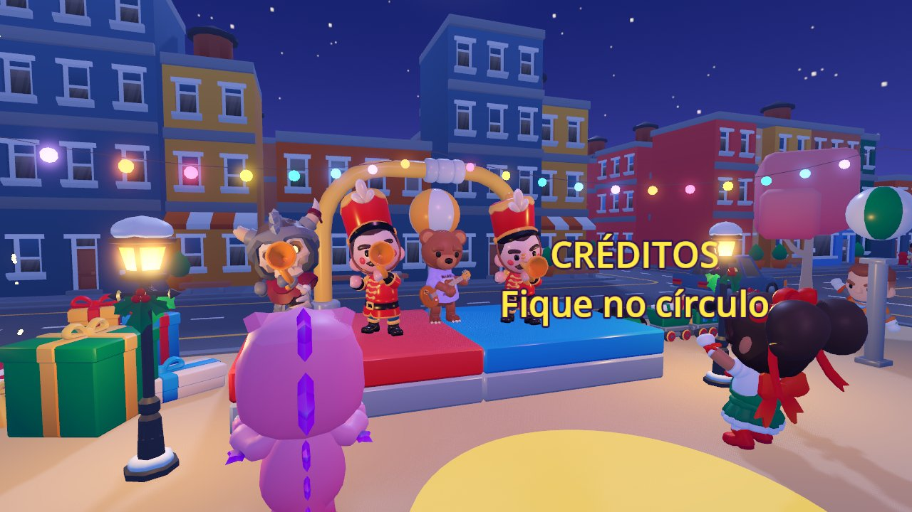<br><sub>A banda no palco; o círculo dourado na frente dele abre os créditos.</sub></td>
  </tr>
  <tr>
    <td>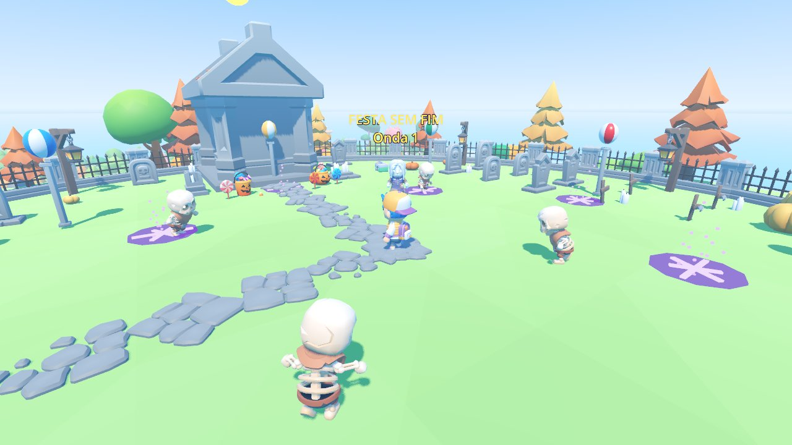<br><sub>Depois da história, a Festa sem fim: ondas sem fim valendo recorde.</sub></td>
    <td>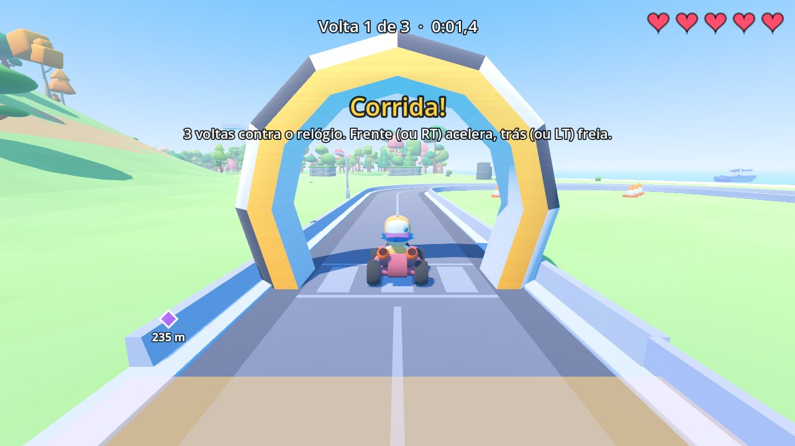<br><sub>Pista de kart: três voltas contra o relógio.</sub></td>
  </tr>
  <tr>
    <td>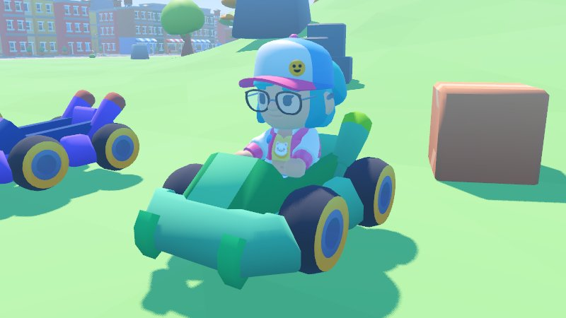<br><sub>Os karts também passeiam pela ilha inteira.</sub></td>
    <td>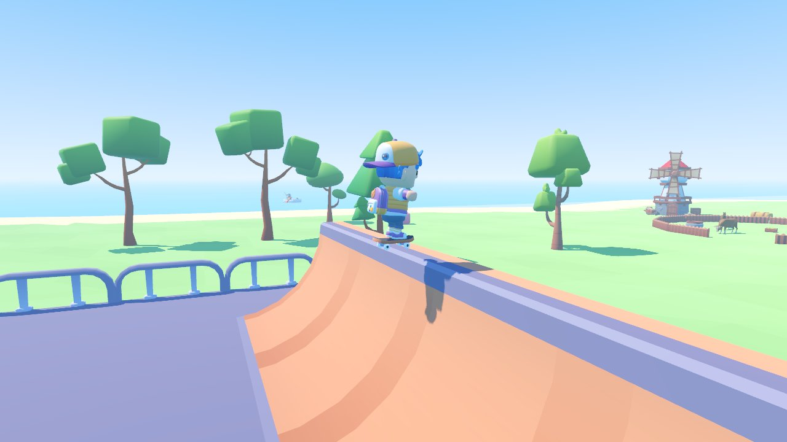<br><sub>Pista de skate com half-pipe, rampas e manobras.</sub></td>
  </tr>
</table>

## O que tem no jogo

- **História completa:** prólogo na praia do cais, duas defesas na cidade (Ossão e Mira-Torta), duas na mata
  (Torre de Ossinhos e Minionzão) e a luta final contra o Mestre Ossinho em três fases. Depois vêm o desfecho, a
  festa à noite com fogos e, no círculo dourado na frente do palco, os créditos com um álbum de fotos da partida.
- **Depois da história:** a ilha fica em festa, com os esqueletos amigos, e a "Festa sem fim" no cemitério traz
  ondas sem fim valendo recorde e moedas.
- **Blasters de doce:** 18 blasters (pistola, metralhadora, escopeta e rifle) que soltam dardos de espuma, com
  pente, recarga e estoque. Com duas pistolas dá para usar uma em cada mão. Também tem granada e o Pirulitão
  para o golpe de perto. A Paçoca vem de início e o resto sai na lojinha do celular, com as moedas das lutas,
  junto com munição e corações; tudo chega de balão.
- **Esqueletos e amigos do Morro:** Minion, Guerreiro, Arqueiro, Mago, Golem, Pistoleiro, Lobinho, Conde,
  Grandalhão e Golem de Gelo, cada um atacando do seu jeito, com brinquedos e doces nas mãos, e seis guardiões.
- **Ilha para explorar:** cidade, praça, cais, mata, rio, Morro dos Ventos, fazenda e o Bosque das Copas, com o
  desafio opcional do Guerreiro Planta. São 22 moradores que conversam, torcem nas ondas e comemoram, além de
  animais e peixes.
- **Diversões:** barraca de tiro ao alvo, pista de kart com 5 karts, pista de skate e barcos no mar. O
  kart e o skate também andam pela ilha inteira, e os esqueletos atacam quem está neles.
- **Feito para criança:** controle com auxílio de mira e vibração, menus que funcionam no controle, interface
  visual com pouco texto e nada assustador.
- **Campanha salva sozinha**, com Continuar e Nova campanha no menu inicial.

## Controles

| Ação | Teclado e mouse | Controle (Xbox / PlayStation) |
|---|---|---|
| Andar / olhar | WASD e mouse | analógicos |
| Correr | Shift | L3 |
| Pular | espaço | A / X |
| Mirar / atirar | botão direito / esquerdo | LT / L2 e RT / R2 |
| Recarregar | R | X / quadrado |
| Granada | G | RB / R1 |
| Pirulitão (golpe de perto) | F | R3 |
| Entrar e sair do kart ou do skate | E | B / círculo |
| Trocar de blaster | 1 a 4 ou rodinha | direcional ou Y |
| Duas pistolas (com duas compradas) | 1 de novo | direcional para cima de novo |
| Lojinha no celular (fora de luta) | C | Select / Share |
| Pausa e comandos | Esc | Start / Options |

## Como rodar

Precisa da [Godot 4.7.2](https://godotengine.org/) com o comando `godot` no terminal. Na pasta do projeto, para
jogar:

```bash
godot --path .
```

Para abrir no editor:

```bash
godot -e --path .
```

Para exportar para Linux (fica em `build/linux/`):

```bash
godot --headless --path . --export-release "Linux" build/linux/IlhaCafune.x86_64
```

Os testes rodam o jogo de verdade, sem janela, e conferem cada parte. Por exemplo, as atividades extras:

```bash
godot --headless --path . -- --atividades
```

Os outros modos são `--salvar`, `--ilha`, `--smoke`, `--controle`, `--loja`, `--combate`, `--som`, `--historia`,
`--final`, `--mata`, `--cemiterio`, `--extras`, `--festa-sem-fim`, `--armas`, `--inimigos` e `--minionzao`.

## Como o projeto é organizado

| Pasta | O que tem |
|---|---|
| `scripts/` | todo o código do jogo em GDScript |
| `scenes/` | a cena principal e a ilha gerada (`ilha.tscn`) |
| `assets/` | só os modelos, texturas e sons que o jogo usa |
| `tools/` | gerador da ilha, gerador de sons, ícones e scripts de fotos |
| `docs/` | a documentação completa e as imagens deste README |

A ilha sai de `tools/gerar_ilha.gd` (`godot --headless --path . -s res://tools/gerar_ilha.gd`). Os sons e a
música são sintetizados por `tools/gerar_sons.py`. A documentação completa (história, mundo, esqueletos,
blasters e notas técnicas) está em [docs/ILHA-CAFUNE.md](docs/ILHA-CAFUNE.md).

## Créditos da arte

Toda a arte vem de pacotes CC0:

- [KayKit](https://kaylousberg.com/), de Kay Lousberg: personagens, esqueletos, animações, cidade, floresta,
  festa, cemitério e mais.
- [Kenney](https://kenney.nl/): blasters (Blaster Kit), karts, pista, skate e barcos.
- [Quaternius](https://quaternius.com/): animais e peixes.

Os efeitos sonoros e a música são gerados por código, sem gravações.
